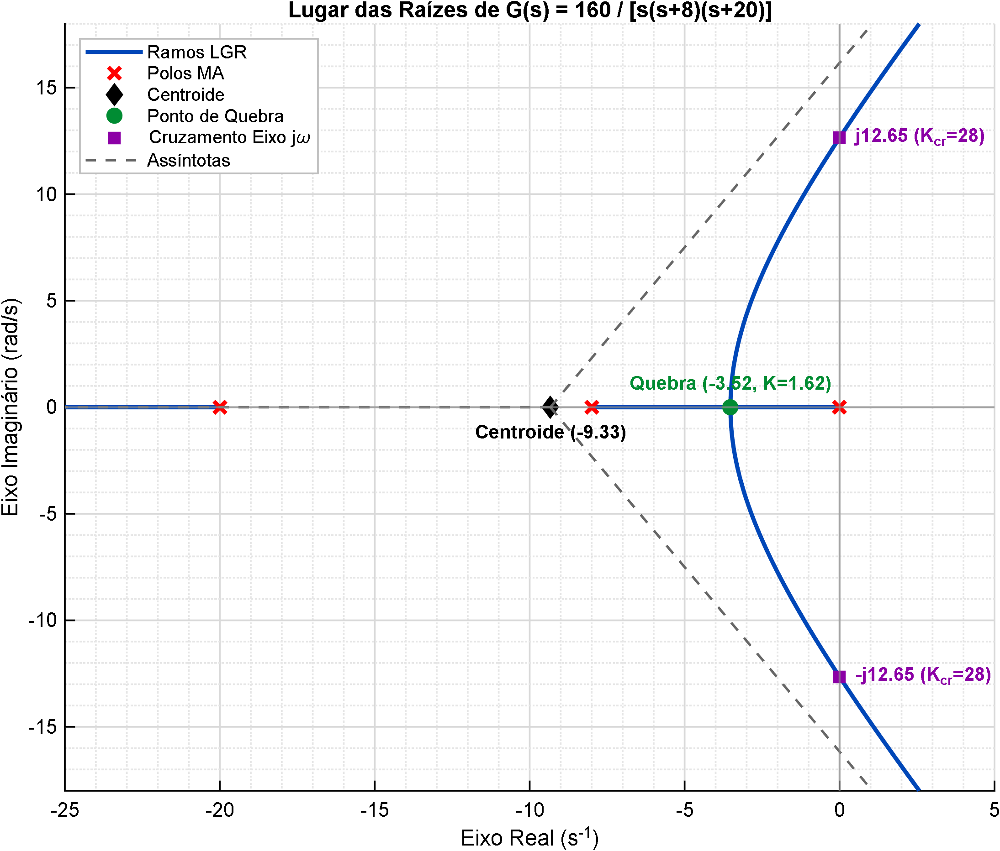
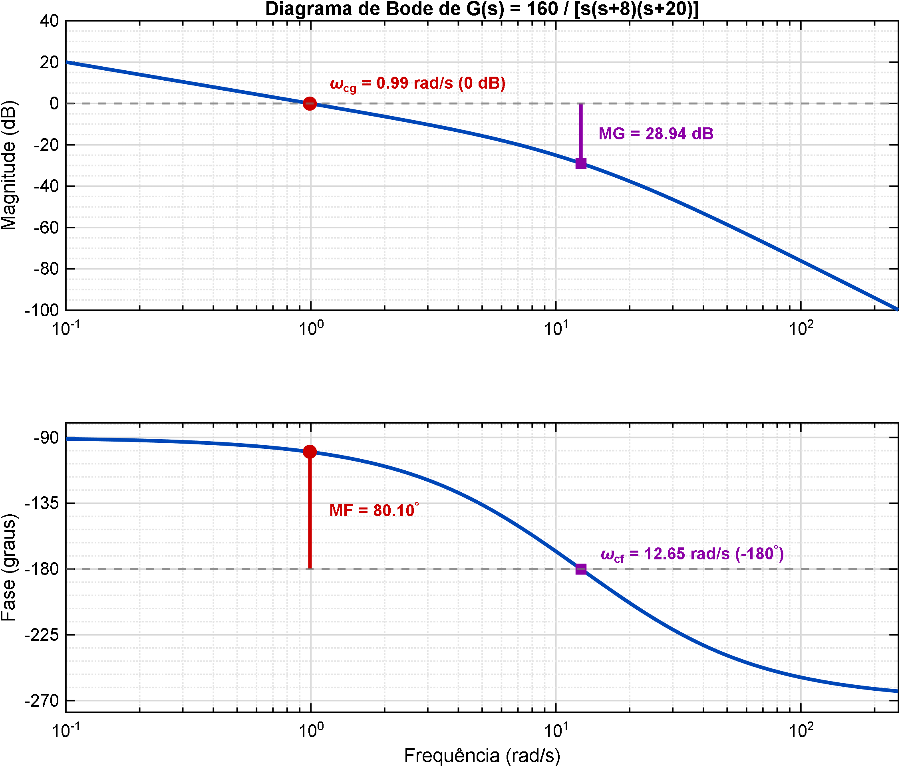
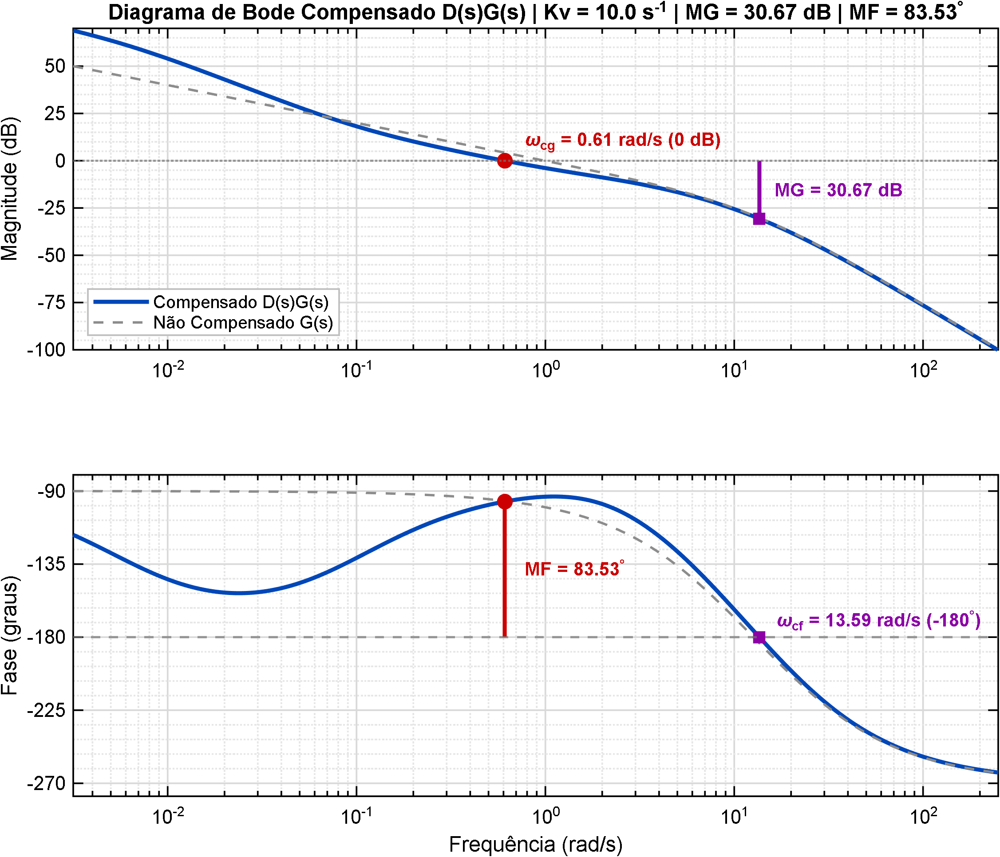
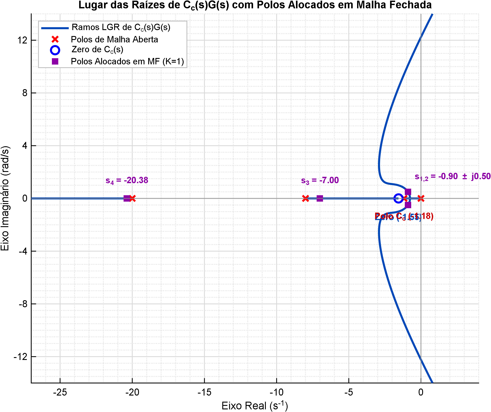
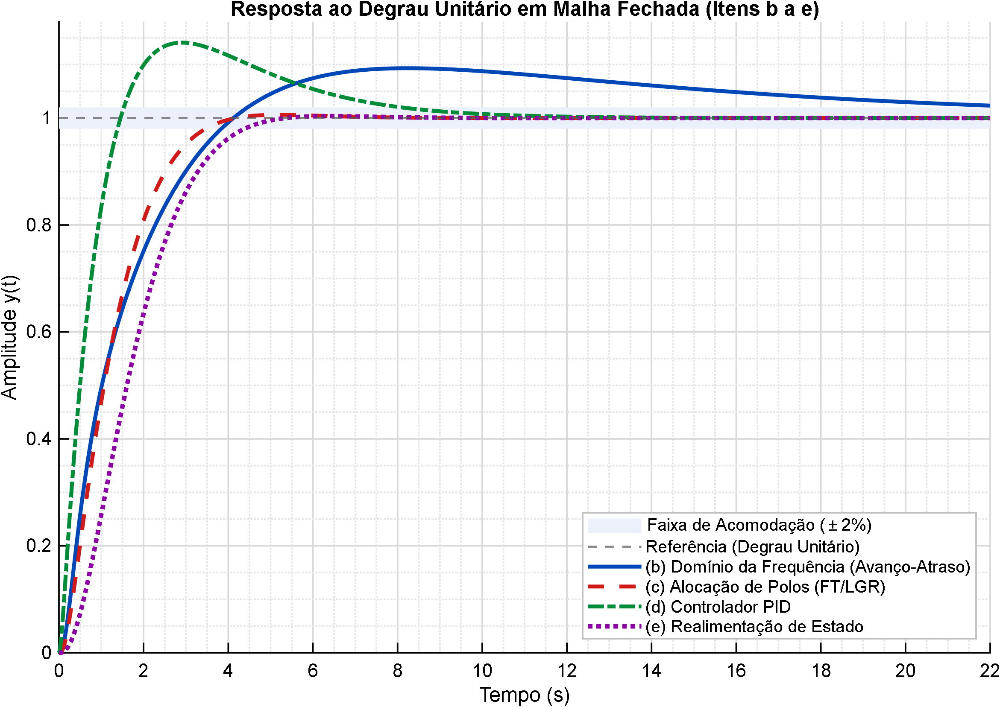

# Projeto Final - Controle 1

17 de novembro de 2026

**Alunos:** Vitor Kenji Zoppo Yamada e Adryan Castro Feres  

- $K = 160$, $a = 8$, $b = 20 \implies G(s) = \dfrac{160}{s(s+8)(s+20)} = \dfrac{160}{s^3 + 28s^2 + 160s}$
---

## Item a

### 1. Lugar das Raízes
A planta possui $n = 3$ polos ($0, -8, -20$) e $m = 0$ zeros finitos. Para $1 + K_{\text{a}}G(s) = 0$:

- **Ramos no eixo real:** Intervalos $(-\infty, -20]$ e $[-8, 0]$.
- **Centroide e ângulos das assíntotas:**
  $$\sigma_a = \frac{0 - 8 - 20}{3 - 0} = -9,33, \qquad \theta_q = \frac{(2q+1)180^\circ}{3} \implies 60^\circ,\ 180^\circ,\ 300^\circ$$
- **Ponto de partida (*breakaway*):**
  $$\frac{d}{ds}(s^3 + 28s^2 + 160s) = 0 \implies 3s^2 + 56s + 160 = 0 \implies s = -3,52 \quad (\text{válido em } [-8, 0])$$

### 2. Critério de Routh-Hurwitz
Para a equação $s^3 + 28s^2 + 160s + 160K_{\text{a}} = 0$:

| Linha | Coluna 1 | Coluna 2 |
| :---: | :---: | :---: |
| $s^3$ | $1$ | $160$ |
| $s^2$ | $28$ | $160K_{\text{a}}$ |
| $s^1$ | $160 - \dfrac{160}{28}K_{\text{a}}$ | $0$ |
| $s^0$ | $160K_{\text{a}}$ | $0$ |

Para estabilidade, exige-se $0 < K_{\text{a}} < 28$. O sistema é marginalmente estável para $K_{\text{c}} = 28$

Usando a linha auxiliar $s^2$:

$$28s^2 + 160(28) = 0 \implies s = \pm j\sqrt{160} = \pm j12,65\text{ rad/s}$$

### 3. Diagrama de Bode e Estabilidade
- **Margem de Ganho ($\omega_{pc} = 12,65\text{ rad/s}$, onde $\angle G(j\omega_{pc}) = -180^\circ$):**
  $$|G(j12,65)| = \frac{160}{12,65\sqrt{12,65^2+64}\sqrt{12,65^2+400}} = 0,0357 \implies MG_{\text{orig}} = 20\log_{10}\left(\frac{1}{0,0357}\right) = 28,94\text{ dB}$$
- **Margem de Fase ($|G(j\omega_{gc})| = 1 \implies \omega_{gc} = 0,99\text{ rad/s}$):**
  $$\angle G(j0,99) = -90^\circ - \arctan\left(\frac{0,99}{8}\right) - \arctan\left(\frac{0,99}{20}\right) = -99,90^\circ \implies MF_{\text{orig}} = 180^\circ - 99,90^\circ = 80,10^\circ$$

**Discussão da Estabilidade:** O sistema em malha fechada unitária sem compensação ($K_{\text{a}} = 1$) é **estável**, pois $0 < 1 < 28$, $MG_{\text{orig}} = 28,94\text{ dB} > 0\text{ dB}$, $MF_{\text{orig}} = 80,10^\circ > 0^\circ$ e $\omega_{gc} < \omega_{pc}$.

> **Valores Finais:** $K_{\text{c}} = 28,00$ ($K_{\text{total,crit}} = 4480,00$); $MG_{\text{orig}} = 28,94\text{ dB}$ em $\omega_{pc} = 12,65\text{ rad/s}$; $MF_{\text{orig}} = 80,10^\circ$ em $\omega_{gc} = 0,99\text{ rad/s}$.

---

## Item b

### 1. Justificativa e Projeto (Avanço-Atraso de Fase)
A planta original possui $K_{v,\text{orig}} = \lim_{s\to 0} sG(s) = 1,00\text{ s}^{-1}$. Ajustar apenas o ganho para $K_{c0} = 10$ reduziria $MG$ para $8,94\text{ dB}$ e $MF$ para $29,09^\circ$. Assim, utiliza-se um compensador avanço-atraso de fase:

$$C_b(s) = K_{c,b}\left(\frac{s + z_{\text{lead}}}{s + p_{\text{lead}}}\right)\left(\frac{s + z_{\text{lag}}}{s + p_{\text{lag}}}\right)$$

1. **Seção de Avanço (*Lead*):** Escolhendo $z_{\text{lead}} = 1,5$ e $p_{\text{lead}} = 2,5$ ($\alpha = 0,6$, avanço máximo $\phi_m = 14,48^\circ$ em $\omega_m = 1,94\text{ rad/s}$), a frequência de cruzamento de fase de $G_{\text{lead}}(s)G(s)$ desloca-se para $\omega_{pc,\text{lead}} = 13,69\text{ rad/s}$, onde $|G_{\text{lead}}(j\omega_{pc})| = 0,9896$, $|G(j\omega_{pc})| = 0,03041$ e $|G_{\text{lead}}(j\omega_{pc})G(j\omega_{pc})| = 0,03009$.
2. **Ganho $K_{c,b}$:** Adotando um alvo de $30,80\text{ dB}$ ($|L|_{\text{alvo}} = 10^{-30,80/20} = 0,02884$) para compensar o leve deslocamento de fase da rede de atraso:
   $$K_{c,b} = \frac{0,02884}{0,03009} = 0,9584$$
3. **Seção de Atraso (*Lag*):** Impondo $K_v = 10\text{ s}^{-1}$ e escolhendo $z_{\text{lag}} = 0,10$:
   $$K_v = K_{c,b}\left(\frac{z_{\text{lead}}}{p_{\text{lead}}}\right)\left(\frac{z_{\text{lag}}}{p_{\text{lag}}}\right)K_{v,\text{orig}} = 10 \implies \beta_{\text{lag}} = \frac{10}{0,9584 \cdot 0,6 \cdot 1} = 17,39 \implies p_{\text{lag}} = \frac{0,10}{17,39} = 0,00575$$

$$C_b(s) = 0,9584\left(\frac{s + 1,5}{s + 2,5}\right)\left(\frac{s + 0,1}{s + 0,00575}\right) = \frac{0,9584s^2 + 1,5334s + 0,1438}{s^2 + 2,5058s + 0,01438}$$

### 2. Verificação das Especificações e Estabilidade (Routh-Hurwitz)
- **Desempenho:** $K_v = \dfrac{0,1438}{0,01438}\cdot 1 = 10,00\text{ s}^{-1}$, $MG = 30,67\text{ dB}$ (em $\omega_{pc} = 13,59\text{ rad/s}$) e $MF = 83,53^\circ$ (em $\omega_{gc} = 0,61\text{ rad/s}$). Todas as especificações foram atendidas.
- **Equação Característica:** $s^5 + 30,51s^4 + 230,18s^3 + 554,67s^2 + 247,65s + 23,00 = 0$

| Linha | Coluna 1 | Coluna 2 | Coluna 3 |
| :---: | :---: | :---: | :---: |
| $s^5$ | $1,00$ | $230,18$ | $247,65$ |
| $s^4$ | $30,51$ | $554,67$ | $23,00$ |
| $s^3$ | $211,99$ | $246,90$ | $0$ |
| $s^2$ | $519,14$ | $23,00$ | $0$ |
| $s^1$ | $237,50$ | $0$ | $0$ |
| $s^0$ | $23,00$ | $0$ | $0$ |

> **Valores Finais – Item (b):** $C_b(s) = \dfrac{0,9584s^2 + 1,5334s + 0,1438}{s^2 + 2,5058s + 0,01438}$; $K_v = 10,00\text{ s}^{-1}$, $MG = 30,67\text{ dB}$, $MF = 83,53^\circ$.

---

## Item c

### 1. Justificativa via LGR e Cálculo Algébrico
Para obter resposta transitória rápida e altamente amortecida sem zeros no semiplano direito, projeta-se $C_c(s) = \frac{b_1 s + b_0}{s + a_0}$ alocando os polos dominantes em $s_{1,2} = -0,90 \pm j0,50$ ($\zeta = 0,87$, $\omega_n = 1,03\text{ rad/s}$) e $s_3 = -7,00$.

Igualando a equação característica $(s+a_0)s(s+8)(s+20) + 160(b_1 s + b_0) = 0$ ao polinômio desejado $(s+0,9-j0,5)(s+0,9+j0,5)(s+7)(s-s_4) = 0$:

$$s^4 + (28 + a_0)s^3 + (160 + 28a_0)s^2 + (160a_0 + 160b_1)s + 160b_0 = s^4 + (8,8 - s_4)s^3 + (13,66 - 8,8s_4)s^2 + (7,42 - 13,66s_4)s - 7,42s_4$$

- **De $s^3$ e $s^2$:** $28 + a_0 = 8,8 - s_4$ e $160 + 28a_0 = 13,66 - 8,8s_4 \implies s_4 = -20,38$ e $a_0 = 1,18$.
- **De $s^1$ e $s^0$:** $160(1,18) + 160b_1 = 285,79 \implies b_1 = 0,61$; $160b_0 = 151,21 \implies b_0 = 0,95$.

$$C_c(s) = \frac{0,61s + 0,95}{s + 1,18}$$

### 2. Verificação (Routh-Hurwitz) e Comparação com o Item (b)

| Linha | Coluna 1 | Coluna 2 | Coluna 3 |
| :---: | :---: | :---: | :---: |
| $s^4$ | $1,00$ | $192,99$ | $151,21$ |
| $s^3$ | $29,18$ | $285,79$ | $0$ |
| $s^2$ | $183,19$ | $151,21$ | $0$ |
| $s^1$ | $261,70$ | $0$ | $0$ |
| $s^0$ | $151,21$ | $0$ | $0$ |

**Comparação com (b):** Elimina a cauda lenta ($t_s = 3,47\text{ s}$ contra $23,19\text{ s}$) e reduz o sobrepasso ($0,59\%$ contra $9,31\%$), porém, por ter apenas 1 polo e 1 zero, reduz $K_v$ para $0,80\text{ s}^{-1}$ e $MF$ para $75,81^\circ$.

> **Valores Finais – Item (c):** $C_c(s) = \dfrac{0,61s + 0,95}{s + 1,18}$; Polos fechados em $-0,90 \pm j0,50$, $-7,00$ e $-20,38$.

---

## Item d

### 1. Justificativa e Cálculo dos Ganhos
O controlador $C_{\text{PID}}(s) = \frac{K_d s^2 + K_p s + K_i}{s}$ eleva a malha aberta para **Tipo 2** ($K_v = \infty$, erro nulo à rampa). A equação característica é:

$$s^2(s+8)(s+20) + 160(K_d s^2 + K_p s + K_i) = s^4 + 28s^3 + (160 + 160K_d)s^2 + 160K_p s + 160K_i = 0$$

Como a soma dos polos fechados é fixa em $-28$, escolhem-se $s_1 = -0,55$, $s_2 = -0,85$ e $s_3 = -8,00$ (cancelando o polo da planta em $-8$), impondo $s_4 = -28 - (-9,4) = -18,60$:

$$P_4(s) = (s+0,55)(s+0,85)(s+8)(s+18,6) = s^4 + 28s^3 + 186,51s^2 + 220,76s + 69,56$$

$$\begin{cases} 160 + 160K_d = 186,51 \implies K_d = 0,1657 \\ 160K_p = 220,76 \implies K_p = 1,3797 \\ 160K_i = 69,56 \implies K_i = 0,4348 \end{cases}$$

Os zeros do PID situam-se em $z_1 = -8,00$ (cancela o polo em $-8$) e $z_2 = -0,33$.

### 2. Verificação (Routh-Hurwitz) e Comparação com o Item (b)

| Linha | Coluna 1 | Coluna 2 | Coluna 3 |
| :---: | :---: | :---: | :---: |
| $s^4$ | $1,00$ | $186,51$ | $69,56$ |
| $s^3$ | $28,00$ | $220,76$ | $0$ |
| $s^2$ | $178,62$ | $69,56$ | $0$ |
| $s^1$ | $209,85$ | $0$ | $0$ |
| $s^0$ | $69,56$ | $0$ | $0$ |

**Comparação com (b):** Proporciona resposta mais rápida ($t_r = 1,03\text{ s}$, $t_s = 8,08\text{ s}$) e erro nulo à rampa ($K_v = \infty$), mas o zero em $-0,33$ eleva o sobrepasso para $14,10\%$ e reduz $MF$ para $72,55^\circ$.

> **Valores Finais – Item (d):** $K_p = 1,3797$, $K_i = 0,4348$, $K_d = 0,1657$.

---

## Item e

### 1. Modelo em Espaço de Estados e Controlabilidade
Na Forma Canônica Controlável ($\dot{\mathbf{x}} = \mathbf{A}\mathbf{x} + \mathbf{B}u$, $y = \mathbf{C}\mathbf{x}$):

$$\mathbf{A} = \begin{bmatrix} 0 & 1 & 0 \\ 0 & 0 & 1 \\ 0 & -160 & -28 \end{bmatrix}, \quad \mathbf{B} = \begin{bmatrix} 0 \\ 0 \\ 1 \end{bmatrix}, \quad \mathbf{C} = \begin{bmatrix} 160 & 0 & 0 \end{bmatrix} \implies \mathcal{M}_c = \begin{bmatrix} 0 & 0 & 1 \\ 0 & 1 & -28 \\ 1 & -28 & 624 \end{bmatrix}$$

Como $\det(\mathcal{M}_c) = -1 \neq 0$, $\text{posto}(\mathcal{M}_c) = 3$ (sistema **controlável**).

### 2. Cálculo de $\mathbf{K}$ (Igualdade Polinomial / Ackermann) e $N_r$
Alocando os polos em $s_{1,2} = -0,90 \pm j0,50$ e $s_3 = -12,0$:

$$P_3(s) = (s^2 + 1,8s + 1,06)(s + 12) = s^3 + 13,80s^2 + 22,66s + 12,72$$

Igualando a $\det(s\mathbf{I} - (\mathbf{A} - \mathbf{B}\mathbf{K})) = s^3 + (28 + k_3)s^2 + (160 + k_2)s + k_1$ (confirmado pela fórmula de Ackermann $\mathbf{K} = \begin{bmatrix}0 & 0 & 1\end{bmatrix}\mathcal{M}_c^{-1}\phi(\mathbf{A})$):

$$\mathbf{K} = \begin{bmatrix} 12,72 & -137,34 & -14,20 \end{bmatrix}, \qquad N_r = -\frac{1}{\mathbf{C}(\mathbf{A}-\mathbf{B}\mathbf{K})^{-1}\mathbf{B}} = \frac{12,72}{160} = 0,08$$

**Comparação com (b):** Aloca todos os polos sem zeros finitos ($M_p = 0,35\%$, $t_s = 4,39\text{ s}$). Os ganhos $k_2, k_3 < 0$ desaceleram os polos originais ($-8$ e $-20$), exige-se um observador para estimar as derivadas da saída e o sistema torna-se Tipo 0 em relação à referência (não segue rampa sem integrador adicional).

> **Valores Finais – Item (e):** $\mathbf{K} = \begin{bmatrix} 12,72 & -137,34 & -14,20 \end{bmatrix}$; $N_r = 0,08$.

---

## Item f

| Controlador | $t_r$ (s) | Sobrepasso $M_p$ (%) | $t_s$ – 2% (s) | $e_{ss}$ (Degrau) | $K_v$ ($\text{s}^{-1}$) |
| :--- | :---: | :---: | :---: | :---: | :---: |
| **(b) Domínio da Frequência (Avanço-Atraso)** | $2,73$ | $9,31$ | $23,19$ | $0,00$ | $10,00$ |
| **(c) Alocação de Polos (FT / LGR)** | $2,20$ | $0,59$ | $3,47$ | $0,00$ | $0,80$ |
| **(d) Controlador PID** | $1,03$ | $14,10$ | $8,08$ | $0,00$ | $\infty$ |
| **(e) Realimentação de Estado** | $2,70$ | $0,35$ | $4,39$ | $0,00$ | N/A (Tipo 0) |

### Comentários e Escolha do Melhor Controlador
- **Desempenho Transitório:** O **PID (d)** possui o menor tempo de subida ($1,03\text{ s}$), porém apresenta o maior sobrepasso ($14,10\%$) devido ao zero em $-0,33$. Os controladores **(e)** ($0,35\%$) e **(c)** ($0,59\%$) praticamente eliminam o sobrepasso e assentam rapidamente ($4,39\text{ s}$ e $3,47\text{ s}$). O controlador **(b)** apresenta o maior tempo de subida ($2,73\text{ s}$) e cauda longa ($t_s = 23,19\text{ s}$) devido ao dipolo lento próximo à origem ($z_{\text{lag}} = -0,10$, $p_{\text{lag}} = -0,00575$).
- **Melhor Controlador:** Para atender integralmente às especificações exigidas ($K_v = 10\text{ s}^{-1}$, $MG \ge 30\text{ dB}$ e $MF \ge 80^\circ$), o **Controlador no Domínio da Frequência (item b)** é o melhor, pois é o único que satisfaz simultaneamente precisão estática e robustez. Sob o critério exclusivo de qualidade transitória ao degrau, destaca-se a **Realimentação de Estado (item e)**.